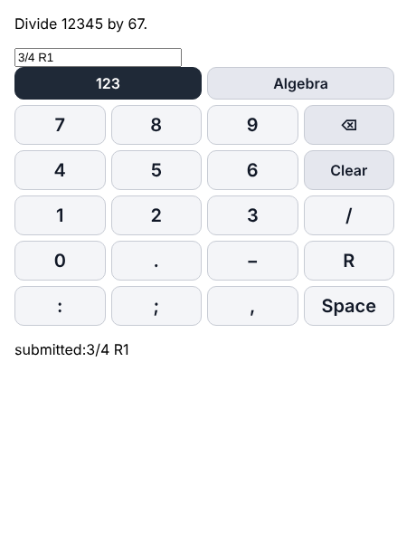
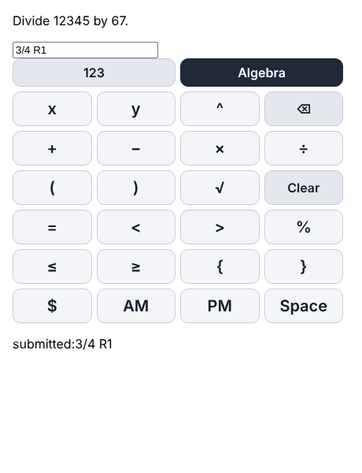

# Engine 0.36.0-rc.1 universal answer pad — verification

**Spec:** [v0.36.0-answer-pad](../change-specs/v0.36.0-answer-pad.md) · **Handbook:** U-18 (approved 2026-10-15), mcada-project-handbook `9d9c80f`
**Date:** 2026-10-15 (Asia/Shanghai) · **Branch:** `implement/v0.36.0` · **Baseline:** `main` `9b2abef`
**Environment:** Linux, Node.js 22.22.0. Headless Chromium with touch emulation, via Python Playwright 1.56. No physical iPad.
**Bundle:** `dist/math-engine-practice.js`, sha256 `45a1b8816e268f6ca69f0ee454cb1dc19dbc360a1244007cdd75866c4745f3b2`
**Raw results:** [practice-v0.36.0-results.json](practice-v0.36.0-results.json)

These results are for the working tree that becomes the implementation checkpoint commit. Rerun on the merged commit before calling it a verified release.

## Results

| Check | Result | Detail |
| --- | --- | --- |
| `node tests/practice.cjs` (50 seeds per item) | Passed | 0 failures; every check Passed |
| — generate, deterministic, own answer accepted, perturbed rejected | Passed | 88,150 / 88,150 each |
| — `keypad-keys-cover-answer`, now including K–7 skills | Passed | 88,150 / 88,150 |
| — `answer-pad-uniform`: every pad item has the identical universal key list | Passed | 80,403 / 80,403 |
| — `pad-typed-answers-accepted` (− for minus, √ for sqrt, × for *) | Passed | 80,403 / 80,403 |
| — `answer-pad-layout`: both tabs in the U-18 order; `keypadKeys()` ignores the item | Passed | 40 keys incl. actions |
| — `radicals-on-pad`: √ entry with and without a written × | Passed | 3 / 3 radical entries |
| — `no-answer-leak`: 8/7 division, zero vs nonzero remainder, same keys; `312R5` accepted | Passed | |
| — `pad-forms`: `5R8`, `11:30AM`, `x≤−10`, `5×(5+5)` | Passed | |
| — `studio-items-identical`: questions unchanged from Studio for the same seed | Passed | 72,050 / 72,050 |
| — K–7 baseline unedited (sha256) | Passed | |
| `npm test` | Passed | `# fail 0` |
| `npm run test:phase2` | Passed | |
| Earlier sweep: all catalog items × 30 seeds, pad-typed answer accepted | Passed | 48,219 / 48,219 |
| Browser: `mountAnswerPad` at 1024×768 and 768×1024, touch | Passed | See below |
| Physical iPad | Not run | Belongs to host verification (U-18, U-10) |

Bank items now on the pad: 1,294 of 1,441. The other 147 keep a text box: word answers, A–E letters, Roman numerals, units and set notation with letters.

## Browser check

Test page: the pad module mounted on a read-only answer field. Tapping was done with touch emulation, in both orientations.

- **Tabs and keys:**
  - **123** opens first and shows `7 8 9 ⌫ 4 5 6 Clear 1 2 3 / 0 . − R : ; , Space`.
  - **Algebra** shows `x y ^ ⌫ + − × ÷ ( ) √ Clear = < > % ≤ ≥ { } $ AM PM Space`.
- **Smallest key:** 101 × 44 px at a 420 px pad width. Hosts can enlarge the pad with `--answer-pad-key-min`.
- **Taps:**
  - `1 8 4 Space R 5` typed `184 R5`.
  - `x ≥ −`, then (123) `3`, then (Algebra) `PM` typed `x≥−3 PM`.
- **`reset()`:** returned to 123 and cleared the answer.
- **Physical keyboard:** `3/4 r2`, Backspace, `1` typed `3/4 R1`, and Enter submitted it.
- **Answer field:** read-only, `inputmode="none"`, so the iPad system keyboard does not open.
- **Keys:** `user-select: none` and `touch-action: manipulation`.
  - The first run showed `touch-action: auto` on the keys, which allows double-tap zoom. This was fixed before the final build and rechecked.

Screenshots:

## Not verified here

- Physical iPad touch, stuck-input and viewport behavior (U-10).
- The pad inside MathQuest or Math Arcade. Both still draw their own pads until their migrations.
